#  Hi, I'm Max.

I'm a **Software Engineering student** based in **Ulm, Germany**. I mainly work with **Java and C#**, and I build games in my spare time.

 email: [bayfrosch@outlook.de](mailto:bayfrosch@outlook.de)

##  What I'm building

<table>
  <tr>
    <td width="50%" valign="top">
      <h3><a href="https://github.com/Bayfrosch/Frontier-Command">Frontier Command</a></h3>
      
GAME DEVELOPMENT &nbsp;·&nbsp; EARLY STAGE

      
A real-time strategy game I'm building in my spare time.

      
<strong>Godot &nbsp;·&nbsp; C#</strong>

      <a href="https://github.com/Bayfrosch/Frontier-Command">Explore the project &rarr;</a>
    </td>
    <td width="50%" valign="top">
      <h3><a href="https://github.com/Bayfrosch/FoodPlaner">Vexa</a></h3>
      
WEB DEVELOPEMENT AND AI USAGE &nbsp;·&nbsp; VIBECODE PROJECT

      
An app for planning meals and managing food, recipes, and lists. I'm using it to explore what AI can build and what it's like to develop with it.

      
<strong>Typescript &nbsp;·&nbsp; React</strong>

      <a href="https://github.com/Bayfrosch/FoodPlaner">Explore the project &rarr;</a>
    </td>
  </tr>
</table>

##  What I work with

 **Languages**

   &nbsp;
   &nbsp;
  

 **Tools**

   &nbsp;
   &nbsp;
  

